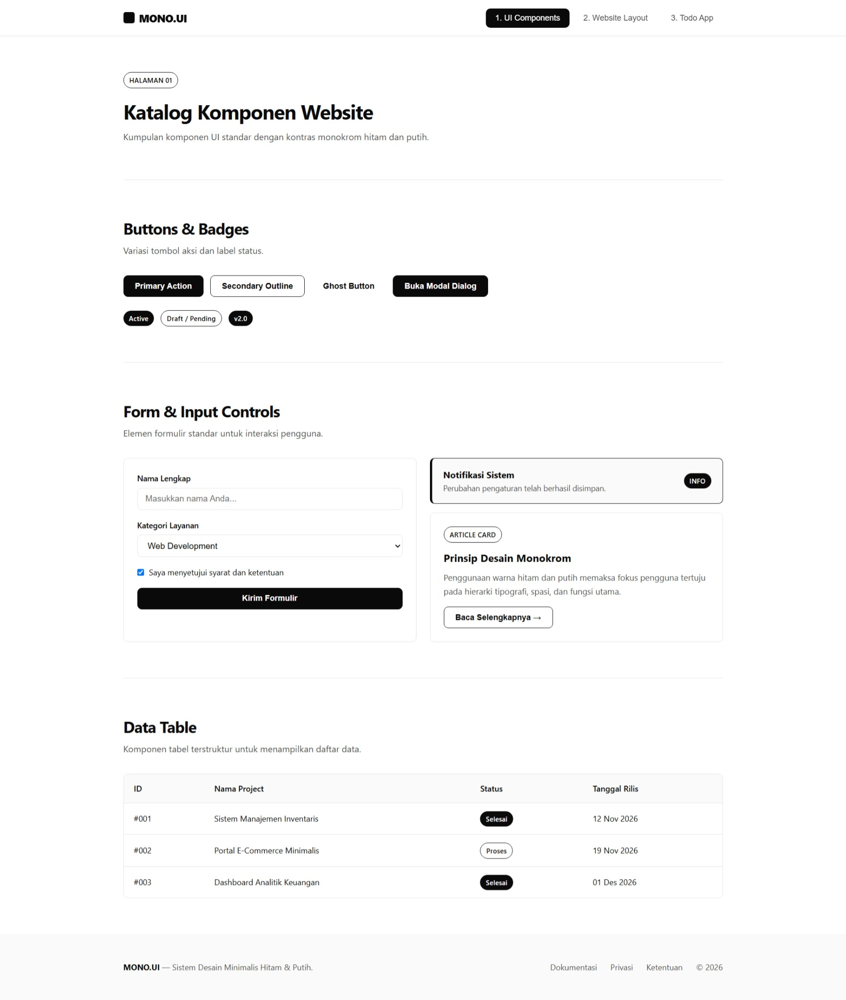

# MONO.UI

MONO.UI adalah katalog komponen dan contoh tata letak website bertema monokrom hitam-putih. Dibangun menggunakan React dan Vite.

---



-> gambar lain bisa dilihat di assets

## Fitur

- Navigasi dua halaman tanpa routing:
  - UI Components
  - Website Layout
- Katalog tombol, badge, formulir, alert, tabel, kartu, dan modal dialog
- Input formulir interaktif
- Contoh hero section, grid fitur, split content, dan CTA
- Tampilan responsif
- Tema visual hitam dan putih

## Teknologi

- React 19
- Vite 8
- JavaScript
- CSS
- ESLint

## Struktur Proyek

```text
react_components/
├── index.html
├── package.json
└── src/
    ├── main.jsx                  # Entry point aplikasi
    ├── App.jsx                   # Pengatur navigasi antar halaman
    ├── index.css                 # Styling tema hitam-putih modern (Global CSS)
    ├── assets/
    │   └── coba_image_gerak.gif
    ├── components/
    │   ├── Navbar.jsx            # Navigasi atas (Reusable)
    │   └── Footer.jsx            # Footer bawah (Reusable)
    └── pages/
        ├── ComponentsPage.jsx    # Halaman 1: Katalog komponen UI umum
        ├── LayoutPage.jsx        # Halaman 2: Tata letak website umum
        └── TodoPage.jsx          # Halaman 3: To-Do App
```

## Menjalankan Proyek

Persyaratan: Node.js dan npm.

```bash
npm install
npm run dev
```

Buka alamat yang ditampilkan oleh Vite, biasanya `http://localhost:5173`.

## Perintah yang Tersedia

```bash
npm run dev      # Jalankan server pengembangan
npm run build    # Membuat build produksi
npm run preview  # Menjalankan hasil build
npm run lint     # Mengecek kode dengan ESLint
```
